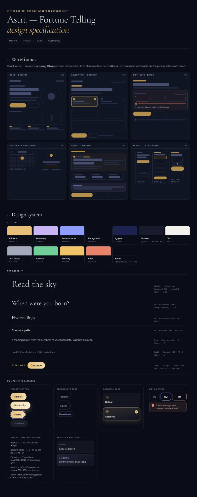

# Astra — Fortune Telling Web Application

เว็บแอปดูดวงออนไลน์ (Node.js \+ Express \+ EJS) ผู้ใช้ Login ด้วย Google เลือกหมวดดูดวง กรอกวันเกิด แล้วรับคำทำนายเฉพาะหมวดนั้น ผลถูกบันทึกลงประวัติอัตโนมัติ ค้นหา กรอง และลบย้อนหลังได้ รายงานนี้รวม Phase 1–4 ของวิชา CP252 Software Engineering

| สมาชิก | รหัสนิสิต | GitHub | บทบาท |
| :---- | :---- | :---- | :---- |
| ชยาภา สุวรรณจินดา (A) | 68102010294 | raindewywy | Scrum lead, Login, Session, User model, UI Design |
| สุรีย์รัตน์ หงษ์กำเนิด (B) | 68102010563 | sureeratnsh | ฟอร์มดูดวง, Validation, Predictor \+ API |
| ธราธร การนา (C) | 68102010204 | tharathon-k | ประวัติ: เรียง, ค้นหา, Profiling |
| ณัฏฐกานต์ สุริยะศรี (D) | 68102010198 | nattakan0112 | CI/CD, Deploy AWS, กรองตามหมวด |

---

# 1\. ที่มา วัตถุประสงค์ และขอบเขต

**ปัญหา:** คนสนใจดูดวงเรื่องความรัก การงาน การเงิน การเรียน แต่คำทำนายกระจายอยู่หลายเว็บและดูแล้วหายไป Astra รวมไว้ที่เดียว เลือกหมวด ใส่วันเกิด รับคำทำนายพร้อมคำแนะนำ และเก็บประวัติให้

**วัตถุประสงค์:** (1) สร้างเว็บดูดวงที่ใช้งานง่าย (2) เลือกหมวดและรับคำทำนายจากวันเกิด (3) ฝึกกระบวนการ SDLC/Scrum ตั้งแต่เก็บ requirement ถึง deploy ด้วย GitHub (Issues, Milestones, Projects, Actions)

**หมวดการดูดวง:** ความรัก (love), การงาน (career), การเงิน (finance), การเรียน (education), ภาพรวมชีวิต (life)

**ขอบเขต (ฉบับปัจจุบัน):** Login Google เท่านั้น · เก็บประวัติต่อผู้ใช้ในหน่วยความจำ (ไม่มีฐานข้อมูล) · ไม่มีระบบชำระเงิน · ไม่มีแชตกับหมอดู · คำทำนายเพื่อความบันเทิง ไม่ใช่คำแนะนำวิชาชีพ · รองรับ Mobile/Tablet/Desktop และ Chrome/Edge/Firefox/Safari

# 2\. Requirements

เก็บจากการสัมภาษณ์รุ่นพี่ (9/9/2569, [วิดีโอ](https://youtu.be/lopJD8CxQZ0)): ดูดวงจากวันเกิด, มีหมวดให้เลือก, มี tutorial, ไม่เก็บข้อมูลส่วนตัว, กรอกหรือเลือกวันเกิดจากปฏิทิน

| ID | Functional Requirement | ID | Non-Functional Requirement |
| :---- | :---- | :---- | :---- |
| FR-01 | หน้าแรกและข้อมูลแนะนำเว็บ | NFR-01 | โหลดและตอบสนองเร็ว |
| FR-02 | เลือกประเภทการดูดวง | NFR-02 | รองรับ Mobile, Tablet, Desktop |
| FR-03 | เลือกวันเกิดจากปฏิทิน | NFR-03 | ทำงานบน Chrome, Edge, Firefox, Safari |
| FR-04 | ตรวจความครบถ้วนถูกต้องของข้อมูล | NFR-04 | ไม่เก็บข้อมูลส่วนตัวลงฐานข้อมูล/server ถาวร |
| FR-05 | แสดง error เมื่อข้อมูลไม่ครบ/ผิด | NFR-05 | ข้อมูลที่กรอกใช้เพื่อคำนวณคำทำนายเท่านั้น |
| FR-06 | ประมวลผลตาม Fortune Algorithm | NFR-06 | เพิ่มประเภท/คำทำนายได้โดยไม่แก้โครงหลัก |
| FR-07 | เลือกคำทำนายตามผลคำนวณ | NFR-07 | ไม่ล่มเมื่อกรอกข้อมูลไม่ครบ |
| FR-08 | แสดงผลคำทำนาย |  |  |
| FR-09 | แสดงคำแนะนำที่เกี่ยวข้อง |  |  |
| FR-10 | เริ่มดูดวงใหม่ |  |  |

**Change Request \#36 (อาจารย์เปลี่ยน requirement หลัง Phase 2):** Login ด้วย Google, ผลแสดงเฉพาะหมวดที่เลือก, ใช้ API/SDK/AI ทำนาย, ประวัติต่อผู้ใช้ที่ค้นหา/กรอง/ลบได้, ใช้ Node.js พร้อม unit test, UI test, profiling และ CI/CD

**ข้อกำหนดของวิชา:** ≥ 4 หน้า (เท่าจำนวนสมาชิก), data structure ใน `models/` ≥ 2 เมธอดต่อคน, คำนวณ ≥ 1 เมธอดต่อคน \+ เมธอดค้นหา, ≥ 10 unit test, statement coverage ของ `models/` ≥ 80%, UI test 5 ข้อ, CI แบบ parallel job

# 3\. กระบวนการทำงาน (Process, Methods, Tools)

| ด้าน | รายละเอียด |
| :---- | :---- |
| **Process** | Agile/Scrum \+ SDLC: Requirement → User Story → GitHub Issues (Product Backlog) → Sprint Planning (Milestone) → Implement → Review → Retrospective พร้อมวิดีโอ |
| **Sprint** | Sprint 1 วิเคราะห์ requirement/เอกสาร · Sprint 3 ถึง 9 พ.ย. · Sprint 4 ถึง 15 พ.ย. · Stand-up ผ่าน Discord สัปดาห์ละ 15 นาที |
| **Backlog** | Phase 1: Issues \#1–\#31 (เอกสาร \#1–\#8, \#23, \#24 · วิดีโอ \#9–\#12 · User Story FR \#13–\#22 และ NFR \#25–\#31) · Phase 3–4: **24 ticket** สมาชิกละ 6 บน GitHub Projects (To Do / In Progress / Review / Done) |
| **Git** | 1 ticket \= 1 branch `<github-user>_T<NN>` \= 1 Pull Request (`Closes #<ticket>`) ให้เพื่อนรีวิวก่อน merge · commit รูปแบบ `[<ticket>]: <message>` (เปลี่ยนจาก Conventional Commits เพื่อย้อนถึง ticket ได้ทันที) |
| **Repo (20 พ.ย. 2569\)** | 127 commit บน `main` (ไม่นับ merge), 26 PR ที่ merge, 25 branch บน remote |
| **ทดสอบ** | Jest \+ Supertest (118 เทส, coverage gate ≥ 80%), Playwright (5 UI test), mock `fetch` เพื่อไม่พึ่งเครือข่าย |
| **Monitor build** | GitHub Actions รันทุก push/PR, ดาวน์โหลด artifact (JUnit, coverage, Playwright report) เมื่อล้ม |
| **จัดการ bug** | แก้พร้อมเทสป้องกันซ้ำ (เช่น หน้า 404/500) และบันทึกส่วนที่ไม่ทันไว้ใน §10 |
| **เครื่องมือ** | GitHub (Issues, Projects, Actions, Pages ใน Phase 1), VS Code, Figma, Discord, กลุ่ม IG (ตามงาน/แจ้ง PR), YouTube (วิดีโอ) |
| **ความปลอดภัย** | secrets (Google, session, AWS) อยู่ใน `.env` ที่ถูก ignore และ GitHub Secrets เท่านั้น มี `.env.example` ค่าว่าง |

# 4\. Design

**Architecture / Flow** (Figma 5 หน้าจอ: Home → Select → Birth Date \+ Error → Calendar \+ Processing → Result)

```
graph LR
    U["User Browser"] --> W1["Home / Login"]
    W1 --> W2["Select category"]
    W2 --> W3["Birth date + validation"]
    W3 -->|"POST /predict"| S["Express: validate, zodiac, predictor"]
    S -->|"API or local fallback"| R["Result (chosen category)"]
    S --> H[("History in memory")]
    R --> U
```

**Use Case:** ผู้ใช้ดูหน้าแรก → เลือกหมวด → กรอกวันเกิด (include ตรวจข้อมูล, extend แสดง error) → ประมวลผล → คัดคำทำนาย → แสดงผลและคำแนะนำ → เริ่มใหม่ (UC-01 ถึง UC-10)



**โครงสร้างโค้ด:** `routes/` → `controllers/` → `models/` (User, Prediction, PredictionHistory) และ `services/` (validator, zodiac, predictor, horoscopeClient, localReadings) · `views/*.ejs` · แยก Algorithm ออกจาก UI ตาม FR/NFR-06

# 5\. สิ่งที่เปลี่ยนจาก Phase 1–2 และเหตุผล

| หัวข้อ | เดิม (Phase 1–2) | ปัจจุบัน | เหตุผล |
| :---- | :---- | :---- | :---- |
| สถาปัตยกรรม | HTML/CSS/JS ล้วน, GitHub Pages | Express \+ EJS | อาจารย์ให้ใช้ Node.js พร้อมเทสและ CI/CD |
| Login | ไม่มี | Google OAuth 2.0 (Passport \+ express-session) | Change Request \#36 |
| ประวัติ | ไม่เก็บ | เก็บอัตโนมัติ ค้นหา กรอง เรียง ลบ | Change Request \#36 |
| ข้อมูล | ไม่มีฐานข้อมูล | ยังไม่มีฐานข้อมูล เก็บใน memory ต่อผู้ใช้ | ตาม scaffold ของวิชา |
| คำทำนาย | ข้อความตายตัว | ราศีจากวันเกิด → API ดวงรายวัน → 5 หมวด, **fallback คำทำนายในเครื่อง 15 ชุดเสมอ** | อาจารย์ให้ใช้ API; ยังไม่ยืนยัน API ฟรีที่เสถียร |
| ตรวจวันเกิด | ฝั่ง Browser | `validateBirthDate` ฝั่ง server \+ `birthdate.js` ฝั่งหน้าเว็บ | ปฏิเสธข้อมูลผิดก่อนทำนายแม้ปิด JavaScript |
| NFR-04/05 | ประมวลผลใน Browser ทั้งหมด | วันเกิดส่งมา server แต่ **ไม่เก็บลงฐานข้อมูล**; ส่ง API ภายนอกเฉพาะ "ราศี" | มี Login และประวัติ จึงทำฝั่ง Browser ล้วนไม่ได้ |
| Commit/Branch | Conventional Commits | `[ticket]: msg`, `<user>_T<NN>` | ตรวจย้อนถึง ticket/Issue |

# 6\. การทำงานของโปรแกรม

**Routes: 11 รายการ — GET 7, POST 4**

| Method | Path | หน้าที่ | Login | Template |
| :---: | :---- | :---- | :---: | :---- |
| GET | `/` | หน้าแรก, ปุ่ม Login, สถิติผู้ใช้ | \- | `home` |
| GET | `/auth/google`, `/auth/google/callback` | Login Google (503 ถ้ายังไม่ตั้งค่า) | \- | \- |
| GET | `/lang/:code` | สลับ TH/EN (เก็บใน session) | \- | \- |
| GET | `/predict` | เลือกหมวดและกรอกวันเกิด | ✓ | `predict` |
| GET | `/result/:id` | ผลคำทำนาย 1 รายการ (เฉพาะของตัวเอง) | ✓ | `result` |
| GET | `/history` | ประวัติ ใหม่→เก่า, `?q=` ค้นหา, `?category=` กรอง | ✓ | `history` |
| POST | `/predict` | ตรวจวันเกิด → ทำนาย → บันทึก → redirect 303 | ✓ | `predict` (เมื่อ error) |
| POST | `/logout` | ออกจากระบบ | ✓ | \- |
| POST | `/history/:id/delete` | ลบรายการของตัวเอง (ของคนอื่น \= 404\) | ✓ | \- |
| POST | `/auth/test-login` | ใช้เฉพาะทดสอบ (`NODE_ENV=test`/`E2E=1`) เพราะ Google บล็อกบอท | \- | \- |

**Template (EJS):** 5 หน้า (`home`, `predict`, `result`, `history`, `error`) \+ 2 partial (`header`, `footer`) ทุก view ได้ `user`, `lang` และ `tr(th, en)` สำหรับ 2 ภาษา; แต่ละหน้ากำหนด CSS/JS ผ่านอาร์เรย์ `styles`/`scripts`; หมวดและตารางวนจาก `CATEGORIES` จึงเพิ่มหมวดได้โดยไม่แก้โครงหลัก

**การเรียก API:** (1) Google OAuth 2.0 ผ่าน `passport-google-oauth20` (2) API ดวงรายวัน ผ่าน `fetch` ไปยัง `HOROSCOPE_API_URL` (`{sign}` แทนด้วยราศี), timeout 3 วินาที ถ้าไม่ตั้งค่า/ล้ม/ช้า ใช้คำทำนายในเครื่องแทน (client ทดสอบกับ mock เท่านั้น ยังไม่ได้ยืนยันกับ API จริง)

**การคำนวณ:** ราศีจากวันเกิด (B) · `luckyScore` ค่าเฉลี่ยคะแนน 3 detail card (B) · `getTotalReadings` นับ และ `getFirstReadingDate` ต่ำสุด (A) · `sortByDate`, `search` (C) · `filterByCategory` (D) · ไม่มี graph ในเวอร์ชันนี้

# 7\. Website Screenshot

ถ่ายจาก `main` ล่าสุด (`3955753` หลังปรับหน้าตาเว็บใน ticket 21\) ผ่าน Playwright (โหมด `E2E=1`, ภาษาไทย)

| ![][image1] หน้าแรก (ยังไม่ Login) |  ![][image2] หน้าแรก (Login แล้ว มีสถิติ) |  ![][image3] เลือกหมวดและวันเกิด |
| ----- | ----- | ----- |
|  ![][image4] Error ปีเกิดไม่ถูกต้อง (FR-05) | ![][image5] ผลเฉพาะหมวดที่เลือก \+ คำแนะนำ | ![][image6] ประวัติ ใหม่→เก่า |
|  ![][image7] ค้นหา `finance` |  ![][image8] กรองหมวด `love` |  ![][image9] หน้า 404 |

# 8\. การทดสอบ

ผลรันบน `main` ล่าสุด (20 พ.ย. 2569): **Jest 118 เทส (18 ไฟล์) ผ่านทั้งหมด**, **Playwright 5 ข้อ ผ่านทั้งหมด** ตารางเต็มทุกเทสสร้างอัตโนมัติด้วย `npm run test:table` ที่ [test/TEST\_CASES.md](./test/TEST_CASES.md)

## 8.1 Unit test ของ data structure (`models/`) — 64 เทส

**ตัวอย่าง test case รายข้อ (16 จาก 64 ข้อ)**

| \# | Class.method | Test case | Expected result | ผล |
| :---: | :---- | :---- | :---- | :---: |
| 1 | `Prediction` constructor | สร้างด้วยหมวด `love` | เก็บ id, userId, category, birthDate, result ตามที่ส่ง | Pass |
| 2 | `Prediction` constructor | สร้างด้วยหมวดที่ไม่มีอยู่ | throw error | Pass |
| 3 | `Prediction.toJSON` | แปลงเป็น JSON | `createdAt` เป็นสตริง ISO | Pass |
| 4 | `Prediction.luckyScore` | คะแนน details \= 90, 80, 70 | `80` (ค่าเฉลี่ย) | Pass |
| 5 | `Prediction.luckyScore` | ไม่มี details | `0` | Pass |
| 6 | `PredictionHistory.add` | reading ไม่มี userId | throw `TypeError` | Pass |
| 7 | `PredictionHistory.getAll` | ผู้ใช้ 2 คนเพิ่มคนละรายการ | แต่ละคนเห็นเฉพาะของตัวเอง | Pass |
| 8 | `PredictionHistory.getAll` | แก้ไขอาร์เรย์ที่ได้คืน | ข้อมูลในประวัติไม่เปลี่ยน (คืนสำเนา) | Pass |
| 9 | `PredictionHistory.sortByDate` | เพิ่ม 3 รายการสลับลำดับวันที่ | เรียงใหม่→เก่า | Pass |
| 10 | `PredictionHistory.search` | ค้นคำตัวพิมพ์ใหญ่/เล็กต่างกัน | พบรายการเดียวกัน | Pass |
| 11 | `PredictionHistory.search` | คำที่ไม่มีในข้อมูล | `[]` | Pass |
| 12 | `PredictionHistory.filterByCategory` | หมวดที่ไม่มีอยู่ในระบบ | `[]` ไม่ throw | Pass |
| 13 | `PredictionHistory.remove` | ลบรายการของผู้ใช้อื่น | คืน `false` และรายการยังอยู่ | Pass |
| 14 | `UserModel.findOrCreate` | Google profile เดิม login ซ้ำ | ได้ user คนเดิม ไม่สร้างใหม่ | Pass |
| 15 | `UserModel.getTotalReadings` | u1 มี 2 รายการ, u2 มี 1 รายการ | u1 \= `2`, u2 \= `1` | Pass |
| 16 | `UserModel.getFirstReadingDate` | เพิ่มรายการไม่เรียงวันที่ | คืนวันที่เก่าที่สุด | Pass |

**สรุปทั้ง 64 ข้อรายไฟล์**

| ไฟล์ | เทส | ตัวอย่าง Expected result |
| :---- | :---: | :---- |
| `prediction.test.js` | 11 | เก็บค่าจาก constructor · `CATEGORIES` มี 5 หมวด · รับทั้ง 5 หมวด · หมวดแปลก throw · `toJSON` เขียน `createdAt` เป็น ISO |
| `luckyScore.test.js` | 5 | คะแนนเป็นค่าเฉลี่ย · ปัด 1 ตำแหน่ง · ไม่มี details \= 0 · ข้ามค่าที่ไม่ใช่ตัวเลข |
| `predictionHistory.test.js` | 9 | เริ่มว่าง · `add` แล้ว `getAll` ได้ · แยกข้อมูลต่อผู้ใช้ · `getAll` คืนสำเนา · `add` ไม่มี userId throw |
| `historySort.test.js` | 5 | ใหม่→เก่าเป็นค่าเริ่มต้น · `asc` เก่า→ใหม่ · ไม่แก้ลำดับที่เก็บ · เฉพาะของผู้ใช้นั้น · ว่าง \= `[]` |
| `historySearch.test.js` | 6 | หาจากคำใน headline · ไม่สนตัวพิมพ์ · ค้นใน description/advice/category · ไม่พบ \= `[]` · คำว่าง \= ทั้งหมด |
| `historyFilter.test.js` | 11 | คืนเฉพาะหมวดนั้น · หมวดที่ไม่เคยใช้ \= `[]` · หมวดแปลก/null/42/`{}` ไม่ throw · ไม่คืนของผู้ใช้อื่น |
| `historyRemove.test.js` | 5 | ลบแล้วคืน `true` · ไม่พบ id คืน `false` · ลบของคนอื่นไม่ได้ · ลบซ้ำสำเร็จครั้งเดียว |
| `user.test.js`, `userModel.test.js` | 8 | สร้าง User จาก Google profile · login ซ้ำได้ user เดิม · ไม่มีชื่อใช้อีเมล · ไม่มี id throw · `findById` |
| `userStats.test.js` | 4 | `getTotalReadings` \= 0 เมื่อไม่มี และนับเฉพาะของผู้ใช้ · `getFirstReadingDate` \= null เมื่อว่าง และคืนวันที่เก่าสุดไม่ว่าลำดับ |

## 8.2 Unit test ส่วนอื่น — 54 เทส

| กลุ่ม | เทส | สิ่งที่ตรวจ |
| :---- | :---: | :---- |
| `birthDateValidator` | 15 | ว่าง/ไม่ครบ · เดือน 0, 13, abc · ปีไม่ครบ 4 หลัก/นอก 1900–ปีนี้ · วัน 0, 32 · 31 เม.ย. · 29 ก.พ. (2000 ผ่าน, 1900/2001 ไม่ผ่าน) · วันในอนาคต · ข้อความไทย |
| `predictor` (zodiac, API, local) | 13 | ราศีถูกต้องตามขอบวัน · API (mock) แปลงเป็น 5 หมวด · API ล้ม → fallback · ไม่ตั้งค่า API → ไม่เรียก · มี 15 คำทำนาย (หมวดละ 3\) · วันเกิดเดียวกันได้ผลเดิม |
| `horoscopeClient` | 5 | ไม่ตั้ง URL \= not configured · อ่านข้อความจาก response · status error → throw · ไม่มีข้อความ → throw · ช้าเกินกำหนด → timeout |
| `auth` | 6 | guest ถูก redirect · login ผ่าน · 503 เมื่อไม่ตั้ง Google · test login · logout · หน้า 404 |
| route `predict` / `history` / `delete` | 15 | guest ถูกส่งกลับหน้าแรก · เห็น 5 การ์ดหมวด · ฟอร์มว่าง/วันอนาคต → error ไม่บันทึก · บันทึกและแสดงเฉพาะหมวดที่เลือก · ไม่เห็นของผู้ใช้อื่น · ค้นหา/ไม่พบ · ลบของตัวเอง, ของคนอื่น 404 |

## 8.3 ตัวอย่างโค้ดเทส

```js
// test/historySort.test.js — เพิ่มข้อมูลสลับลำดับโดยตั้งใจ แล้วตรวจ expected result
history.add(middle); history.add(recent); history.add(old);

test('puts the newest reading first by default', () => {
  expect(history.sortByDate('u1')).toEqual([recent, middle, old]);
});
test('does not change the order stored in the history', () => {
  history.sortByDate('u1');
  expect(history.getAll('u1')).toEqual([middle, recent, old]);
});
```

## 8.4 Test coverage (เกณฑ์ statement `models/` ≥ 80%)

| ไฟล์ | Stmts | Branch | Funcs | Lines |
| :---- | ----: | ----: | ----: | ----: |
| `Prediction.js` | 100 | 100 | 100 | 100 |
| `PredictionHistory.js` | 100 | 100 | 100 | 100 |
| `User.js` | 100 | 95.83 | 100 | 100 |
| **รวม** | **100 (82/82)** | 98.3 | 100 | 100 |

`jest.config.js` ตั้ง `coverageThreshold` ให้ build ล้มเมื่อต่ำกว่า 80% รายงาน HTML ที่ `coverage/` สร้างใหม่ได้

## 8.5 UI test (Playwright, 5 ข้อ, ทุกข้อมี `expect` ตรวจ expected result)

| \# | ไฟล์ | ขั้นตอน | Expected result | ผล |
| :---: | :---- | :---- | :---- | :---: |
| 1 | `login.spec.js` | Login (test login) แล้วเปิดหน้าแรก | แสดงชื่อผู้ใช้ | ✓ |
| 2 | `predict.spec.js` | ดูดวงหมวด `finance` | result card 1 ใบ และ `data-category` \= `finance` | ✓ |
| 3 | `predict.spec.js` | ดูดวง `career` แล้วเปิด `/history` | 1 แถว, `data-category` \= `career` | ✓ |
| 4 | `predict.spec.js` | ดูดวง `love`\+`finance` แล้วค้นหา `finance` / กรอง `love` | ค้นหาเหลือ 1 แถว · กรองเหลือ 1 แถวเป็น `love` | ✓ |
| 5 | `delete.spec.js` | ดูดวง `education` แล้วลบ | แถวเหลือ 0 และแสดง empty state | ✓ |

ตัวอย่างโค้ด (`tests/delete.spec.js`) แต่ละ `expect` มีข้อความบอกค่าที่คาดไว้

```js
test('UI 5: deleting a reading removes it from the history', async ({ page }) => {
  await login(page);
  await makeReading(page, 'education');
  await page.goto('/history');
  const before = await page.locator('.history-table tbody tr').count();
  expect(before, `Expected 1 row before deleting but got ${before}`).toBe(1);

  await page.locator('.history-table tbody tr button[type="submit"]').first().click();
  await page.waitForURL(/\/history$/);
  const after = await page.locator('.history-table tbody tr').count();
  expect(after, `Expected 0 rows after deleting but got ${after}`).toBe(0);
  expect(await page.locator('.empty').isVisible(), 'Expected the empty state').toBe(true);
});
```

`playwright.config.js` เปิดเซิร์ฟเวอร์เองด้วย `webServer: npm start` และ `E2E=1` (เปิด test login, ข้าม animation 2.4 วินาที, ปิด Google/API ภายนอก) แต่ละเทสใช้อีเมลใหม่ ข้อความ error ระบุค่าที่คาดไว้/ได้จริง
