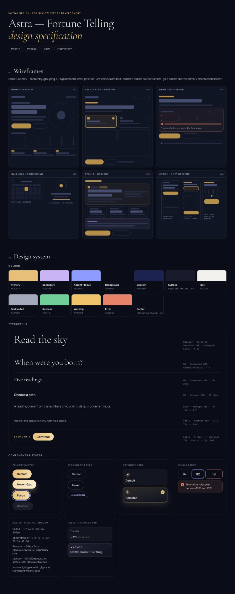

# Astra — Fortune Telling Web Application

เว็บแอปดูดวงออนไลน์ (Node.js \+ Express \+ EJS) ผู้ใช้ Login ด้วย Google เลือกหมวดดูดวง กรอกวันเกิด แล้วรับคำทำนายเฉพาะหมวดนั้น ผลถูกบันทึกลงประวัติอัตโนมัติ ค้นหา กรอง และลบย้อนหลังได้ รายงานนี้รวม Phase 1–4 ของวิชา CP252 Software Engineering

| สมาชิก | รหัสนิสิต | GitHub | บทบาท |
| :---- | :---- | :---- | :---- |
| ชยาภา สุวรรณจินดา (A) | 68102010294 | raindewywy | Scrum lead, Login, Session, User model, UI Design |
| สุรีย์รัตน์ หงษ์กำเนิด (B) | 68102010563 | sureeratnsh | ฟอร์มดูดวง, Validation, Predictor \+ API |
| ธราธร การนา (C) | 68102010204 | tharathon-k | ประวัติ: เรียง, ค้นหา, Profiling |
| ณัฏฐกานต์ สุริยะศรี (D) | 68102010198 | nattakan0112 | CI/CD, Deploy AWS, กรองตามหมวด |

---

# 1\. ที่มา วัตถุประสงค์ และขอบเขต

**ปัญหา:** คนสนใจดูดวงเรื่องความรัก การงาน การเงิน การเรียน แต่คำทำนายกระจายอยู่หลายเว็บและดูแล้วหายไป Astra รวมไว้ที่เดียว เลือกหมวด ใส่วันเกิด รับคำทำนายพร้อมคำแนะนำ และเก็บประวัติให้

**วัตถุประสงค์:** (1) สร้างเว็บดูดวงที่ใช้งานง่าย (2) เลือกหมวดและรับคำทำนายจากวันเกิด (3) ฝึกกระบวนการ SDLC/Scrum ตั้งแต่เก็บ requirement ถึง deploy ด้วย GitHub (Issues, Milestones, Projects, Actions)

**หมวดการดูดวง:** ความรัก (love), การงาน (career), การเงิน (finance), การเรียน (education), ภาพรวมชีวิต (life)

**ขอบเขต (ฉบับปัจจุบัน):** Login Google เท่านั้น · เก็บประวัติต่อผู้ใช้ในหน่วยความจำ (ไม่มีฐานข้อมูล) · ไม่มีระบบชำระเงิน · ไม่มีแชตกับหมอดู · คำทำนายเพื่อความบันเทิง ไม่ใช่คำแนะนำวิชาชีพ · รองรับ Mobile/Tablet/Desktop และ Chrome/Edge/Firefox/Safari

# 2\. Requirements

เก็บจากการสัมภาษณ์รุ่นพี่ (9/9/2569, [วิดีโอ](https://youtu.be/lopJD8CxQZ0)): ดูดวงจากวันเกิด, มีหมวดให้เลือก, มี tutorial, ไม่เก็บข้อมูลส่วนตัว, กรอกหรือเลือกวันเกิดจากปฏิทิน

| ID | Functional Requirement | ID | Non-Functional Requirement |
| :---- | :---- | :---- | :---- |
| FR-01 | หน้าแรกและข้อมูลแนะนำเว็บ | NFR-01 | โหลดและตอบสนองเร็ว |
| FR-02 | เลือกประเภทการดูดวง | NFR-02 | รองรับ Mobile, Tablet, Desktop |
| FR-03 | เลือกวันเกิดจากปฏิทิน | NFR-03 | ทำงานบน Chrome, Edge, Firefox, Safari |
| FR-04 | ตรวจความครบถ้วนถูกต้องของข้อมูล | NFR-04 | ไม่เก็บข้อมูลส่วนตัวลงฐานข้อมูล/server ถาวร |
| FR-05 | แสดง error เมื่อข้อมูลไม่ครบ/ผิด | NFR-05 | ข้อมูลที่กรอกใช้เพื่อคำนวณคำทำนายเท่านั้น |
| FR-06 | ประมวลผลตาม Fortune Algorithm | NFR-06 | เพิ่มประเภท/คำทำนายได้โดยไม่แก้โครงหลัก |
| FR-07 | เลือกคำทำนายตามผลคำนวณ | NFR-07 | ไม่ล่มเมื่อกรอกข้อมูลไม่ครบ |
| FR-08 | แสดงผลคำทำนาย |  |  |
| FR-09 | แสดงคำแนะนำที่เกี่ยวข้อง |  |  |
| FR-10 | เริ่มดูดวงใหม่ |  |  |

**Change Request \#36 (อาจารย์เปลี่ยน requirement หลัง Phase 2):** Login ด้วย Google, ผลแสดงเฉพาะหมวดที่เลือก, ใช้ API/SDK/AI ทำนาย, ประวัติต่อผู้ใช้ที่ค้นหา/กรอง/ลบได้, ใช้ Node.js พร้อม unit test, UI test, profiling และ CI/CD

**ข้อกำหนดของวิชา:** ≥ 4 หน้า (เท่าจำนวนสมาชิก), data structure ใน `models/` ≥ 2 เมธอดต่อคน, คำนวณ ≥ 1 เมธอดต่อคน \+ เมธอดค้นหา, ≥ 10 unit test, statement coverage ของ `models/` ≥ 80%, UI test 5 ข้อ, CI แบบ parallel job

# 3\. กระบวนการทำงาน (Process, Methods, Tools)

| ด้าน | รายละเอียด |
| :---- | :---- |
| **Process** | Agile/Scrum \+ SDLC: Requirement → User Story → GitHub Issues (Product Backlog) → Sprint Planning (Milestone) → Implement → Review → Retrospective พร้อมวิดีโอ |
| **Sprint** | Sprint 1 วิเคราะห์ requirement/เอกสาร · Sprint 3 ถึง 9 พ.ย. · Sprint 4 ถึง 15 พ.ย. · Stand-up ผ่าน Discord สัปดาห์ละ 15 นาที |
| **Backlog** | Phase 1: Issues \#1–\#31 (เอกสาร \#1–\#8, \#23, \#24 · วิดีโอ \#9–\#12 · User Story FR \#13–\#22 และ NFR \#25–\#31) · Phase 3–4: **24 ticket** สมาชิกละ 6 บน GitHub Projects (To Do / In Progress / Review / Done) |
| **Git** | 1 ticket \= 1 branch `<github-user>_T<NN>` \= 1 Pull Request (`Closes #<ticket>`) ให้เพื่อนรีวิวก่อน merge · commit รูปแบบ `[<ticket>]: <message>` (เปลี่ยนจาก Conventional Commits เพื่อย้อนถึง ticket ได้ทันที) |
| **Repo (20 พ.ย. 2569\)** | 127 commit บน `main` (ไม่นับ merge), 26 PR ที่ merge, 25 branch บน remote |
| **ทดสอบ** | Jest \+ Supertest (118 เทส, coverage gate ≥ 80%), Playwright (5 UI test), mock `fetch` เพื่อไม่พึ่งเครือข่าย |
| **Monitor build** | GitHub Actions รันทุก push/PR, ดาวน์โหลด artifact (JUnit, coverage, Playwright report) เมื่อล้ม |
| **จัดการ bug** | แก้พร้อมเทสป้องกันซ้ำ (เช่น หน้า 404/500) และบันทึกส่วนที่ไม่ทันไว้ใน §10 |
| **เครื่องมือ** | GitHub (Issues, Projects, Actions, Pages ใน Phase 1), VS Code, Figma, Discord, กลุ่ม IG (ตามงาน/แจ้ง PR), YouTube (วิดีโอ) |
| **ความปลอดภัย** | secrets (Google, session, AWS) อยู่ใน `.env` ที่ถูก ignore และ GitHub Secrets เท่านั้น มี `.env.example` ค่าว่าง |

# 4\. Design

**Architecture / Flow** (Figma 5 หน้าจอ: Home → Select → Birth Date \+ Error → Calendar \+ Processing → Result)

```
graph LR
    U["User Browser"] --> W1["Home / Login"]
    W1 --> W2["Select category"]
    W2 --> W3["Birth date + validation"]
    W3 -->|"POST /predict"| S["Express: validate, zodiac, predictor"]
    S -->|"API or local fallback"| R["Result (chosen category)"]
    S --> H[("History in memory")]
    R --> U
```

**Use Case:** ผู้ใช้ดูหน้าแรก → เลือกหมวด → กรอกวันเกิด (include ตรวจข้อมูล, extend แสดง error) → ประมวลผล → คัดคำทำนาย → แสดงผลและคำแนะนำ → เริ่มใหม่ (UC-01 ถึง UC-10)



**โครงสร้างโค้ด:** `routes/` → `controllers/` → `models/` (User, Prediction, PredictionHistory) และ `services/` (validator, zodiac, predictor, horoscopeClient, localReadings) · `views/*.ejs` · แยก Algorithm ออกจาก UI ตาม FR/NFR-06
